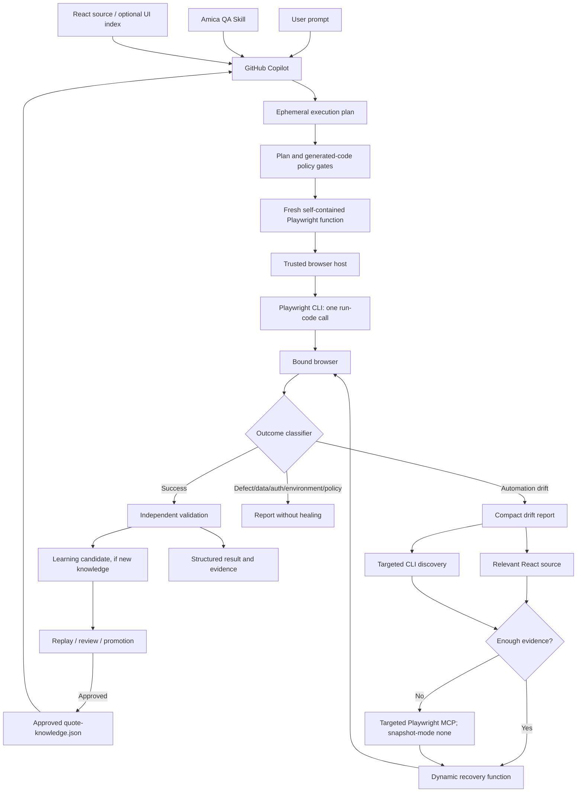

# Amica AI Quote Testing Architecture

## 1. Purpose

Build an adaptive QA system in which GitHub Copilot interprets a natural-language quote request and generates a **fresh** self-contained Playwright program for that exact scenario. The core performance principle is:

> AI reasons about the requested flow once; deterministic Playwright executes the repetitive browser interactions in one CLI `run-code` invocation. AI returns only when judgment is needed.

The first milestone is a local synthetic React quote fixture. Do not use production, live customer information, or unapproved operations.

## 2. Non-negotiable decisions

- **Dynamic test generation:** No prewritten test case is required for each requested scenario.
- **Independent of existing tests:** Do not derive selectors, flow logic, branches, or fixtures from Playwright, Cypress, Selenium, page objects, test helpers, or manual test scripts. Their locations can be identified to avoid modifying them.
- **Allowed context:** User prompt, Amica skill, approved `automation/quote-knowledge.json`, relevant React application source, optional generated React UI index, and targeted browser discovery.
- **One-shot happy path:** Generate the complete Playwright function before execution; use Playwright CLI rather than an AI/MCP call per action.
- **MCP last:** Only use targeted MCP after a confirmed `AUTOMATION_DRIFT` when compact evidence, React source, and targeted CLI inspection are insufficient. Automatic full snapshots must be off.
- **One persistent learned file:** `automation/quote-knowledge.json`; neither a permanent `quote-request.json` nor static `quote-flow.json` is required.
- **Controlled learning:** Recovery yields a candidate, never a direct edit to approved knowledge.
- **Non-production by default:** Deny unapproved origins and mutations such as bind, payment, issuance, cancellation, and destructive Guidewire operations.

## 3. Responsibilities

| Component | Responsibility |
|---|---|
| User | Describe scenario, evidence, stop point, validations |
| GitHub Copilot | Interpret intent, create plan, generate one-shot code, review structured outcomes |
| Amica QA Skill | Rules for context, locators, generation, recovery, validation, and learning |
| `quote-knowledge.json` | Approved, scoped facts about observed pages, controls, transitions, and branches |
| React source | Current implementation facts: routes, components, labels, test IDs, conditionals, choices |
| Ephemeral execution plan | Scenario, environment, assertions, screenshots, checkpoints, permissions |
| Policy gate | Deterministically validate plan and generated program |
| Trusted TypeScript runner | Own browser/context, auth, network restrictions, traces, execution, cleanup |
| Playwright CLI | Run all quote interactions as one self-contained `run-code` function |
| Outcome classifier | Distinguish drift from defects, data/auth/environment failures |
| Playwright MCP | Specialist investigator on the same browser session, targeted inspection only |
| Learning promoter | Replay, review, and approve changes to knowledge |
| Evidence system | Record checkpoints, outcomes, artifacts, console/network failures |

## 4. Main flowchart



## 5. Execution plan

Copilot converts the request to a structured, **temporary** plan, validated before code generation. It records:
- run ID, approved environment and origins;
- product, jurisdiction, synthetic scenario, authentication profile reference;
- exact stop/completion point, screenshots, assertions;
- ordered semantic checkpoints;
- allowed mutation level;
- optional application build and feature-flag scope.

Example prompt: “Run a Rhode Island Auto quote for a 35-year-old with a 2025 Honda Accord, screenshot Driver Info, stop at Coverage.”

The plan is ephemeral; a redacted copy may be written to ignored `.quote-agent/runs/<runId>/plan.json` for auditing. No canonical `quote-request.json` exists.

## 6. Security and execution boundary

Generated code is **untrusted**. A Copilot instruction or skill does not enforce security.

The trusted runner must:
1. Validate the plan against JSON Schema and policy.
2. Parse the generated JavaScript/TypeScript with an AST-based validator.
3. Reject shell/child-process calls, arbitrary file access, `eval`, `Function`, dynamic loading, `process` access, environment enumeration, unrestricted network and unapproved mutations.
4. Enforce network/host allowlists and denied production destinations *outside* the generated function.
5. Use an isolated execution environment with least-privilege test identities.
6. Prepare a secure ignored run directory and logs; redact credentials/PII.
7. Launch and preserve an isolated browser context; attach CLI and, when necessary, MCP to the **same** bound browser session.
8. Invoke one `run-code` operation and parse the returned structured result.
9. Retain trace/screenshot evidence according to policy and clean up the session.

AST screening alone is not a sandbox. Host/network restrictions must be enforced by trusted infrastructure. Login state is secret material and must never be committed.

## 7. Why a shared browser matters

On drift, Copilot must inspect the exact page reached by the original quote run, not start a new quote in another browser. The browser host should use the supported browser-bind/CLI-attach/MCP-endpoint mechanism for the installed Playwright version. Codify and test this compatibility; do not guess CLI flags.

Conceptual sequence:

```text
Trusted host starts isolated authenticated browser
  ├─ Playwright CLI attaches → one-shot run-code
  └─ On confirmed drift, targeted MCP attaches to that same browser
```

## 8. Generating a fast test

Before browser execution, Copilot uses:
1. prompt and Amica skill;
2. approved knowledge matching environment/product/state/build/flags;
3. relevant React source only where needed;
4. targeted discovery only where knowledge is insufficient.

Locator preference: `getByTestId`, `getByRole` with accessible name, `getByLabel`, `getByPlaceholder`, stable exact text, and finally stable CSS. Do not generate brittle XPath or long DOM-dependent selectors.

The generated script is a single self-contained Playwright function expression with no imports/requires, fixed sleeps, shell access, or unrestricted I/O. It verifies semantic checkpoints and returns JSON conforming to `schemas/run-result.schema.json`.

## 9. Semantic checkpoints

After each logical page transition, verify a fingerprint combining:
- URL or route pattern;
- visible page heading;
- one or more unique controls;
- optional relevant network response.

Record last successful checkpoint and expected next checkpoint so a drift report points to the exact change. A click not throwing is not proof the intended page was reached.

## 10. Outcome classification (before healing)

- `SUCCESS`: Requested stopping point reached; validations and requested evidence succeed.
- `AUTOMATION_DRIFT`: Healthy app with stale locator, inserted legitimate page, new branch, or changed sequence.
- `APPLICATION_DEFECT`: App exception, broken button, server/rating error, or invalid product response.
- `TEST_DATA_FAILURE`: Unsupported or invalid scenario.
- `AUTHENTICATION_FAILURE`: Session expired, unauthorized response, login redirect.
- `ENVIRONMENT_FAILURE`: Infrastructure, DNS, connection, or dependency unavailable.
- `POLICY_VIOLATION`: Request/code violates approved limits.
- `NEEDS_REVIEW`: Unclear or conflicting evidence.

Only **confirmed automation drift** enters healing. Never conceal an actual product defect by clicking around it.

## 11. Targeted recovery

Recovery escalation:
1. Return a compact report with URL, last/expected checkpoint, heading, relevant controls, failed requests, console errors, optional screenshot.
2. Examine relevant React code.
3. Use targeted CLI `find` or partial inspection.
4. Use MCP only when still necessary, with automatic snapshots off and explicit narrow discovery.
5. Let Copilot generate **one** recovery function to complete the remaining flow.
6. Revalidate; if unresolved, stop with `NEEDS_REVIEW`.

Do not return to a sequence of one AI tool call per field.

## 12. Knowledge and promotion

`automation/quote-knowledge.json` stores **facts**, never a static test. Entries should be scoped by environment, product, jurisdiction, deployed build, feature flags, and optional quote variant, including confidence, verification count, timestamps, supporting evidence and status (active, superseded, deprecated).

A new page/branch/locator observed during recovery becomes a learning candidate. The trusted promoter:
1. independently checks successful run and observed behavior;
2. associates evidence and compatible scope;
3. replays selected synthetic scenarios;
4. checks duplicates/conflicts and stale facts;
5. applies human review for business-flow/underwriting/eligibility changes;
6. atomically promotes approved facts.

Do not automatically treat a local React source change as deployed QA behavior without build compatibility evidence.

## 13. Evidence and per-run artifacts

Each result should include run ID, status, environment/build, duration, checkpoints, branches, assertions, final URL, screenshot paths, trace on failure, console/network summary, and any candidate path. Quote IDs/premiums only if requested and safe.

Use ignored `.quote-agent/runs/<runId>/` for redacted plan, generated function, policy report, result, drift report, screenshot and trace. Do not append raw sensitive run data to `quote-knowledge.json`.

## 14. Implementation sequence

Follow `docs/BUILD_PHASES.md`:

- **Phase 0:** Repository discovery. Identify React source and test directories without deriving knowledge from tests.
- **Phase 1:** Contracts, JSON Schemas, plan/code gates, safe local fixture, unit tests.
- **Phase 2:** Trusted browser, CLI one-shot runner, checkpoints and evidence.
- **Phase 3:** Outcome classification and CLI-first recovery.
- **Phase 4:** Targeted MCP fallback on the same browser, snapshot-mode none.
- **Phase 5:** Versioned learned knowledge, replay, review and promotion.

Build one phase at a time with review and measured acceptance criteria. Do not invent real QA addresses, secrets, selectors, credentials or business rules.

## 15. Phase 1/2 milestone

For a synthetic local React fixture, demonstrate:
- natural-language prompt → validated ephemeral plan;
- fresh generated Playwright function → deterministic code policy gate;
- **one** CLI `run-code` for all quote interactions;
- checkpoints through Applicant, Driver, Vehicle, Coverage;
- screenshot at Driver Information and stop at Coverage;
- validated structured result and no MCP on success;
- no dependency on existing automated tests;
- production/bind/payment code rejected by policy.

The eventual enterprise extension may add Quote/Bind, Guidewire PolicyCenter/BillingCenter/ClaimCenter checks, Jira evidence and CI, but these are outside initial authorization.
